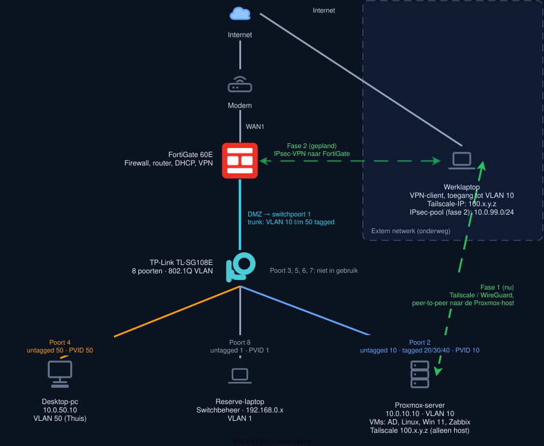
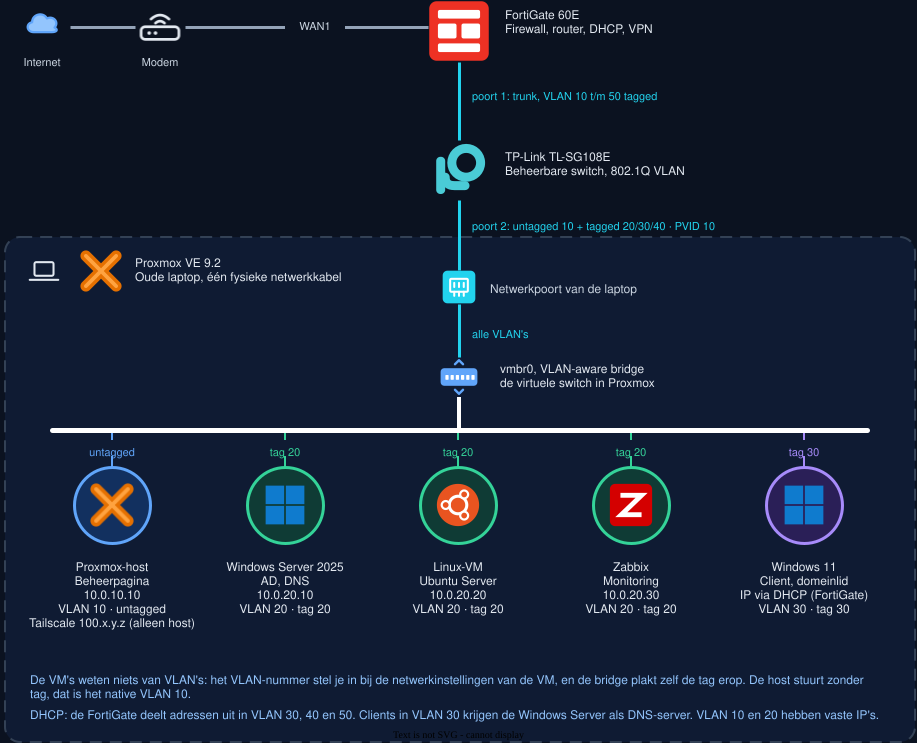

# Home Network Lab

Een kleinschalige bedrijfsomgeving, opgebouwd vanuit mijn passie voor systeem- en netwerkbeheer. De infrastructuur bestaat uit een gebruikte FortiGate 60E die fungeert als firewall en router, een beheerbare TP-Link-switch die het netwerk onderverdeelt in vijf VLAN's en een Proxmox-server waarop verschillende virtuele machines draaien, waaronder Active Directory, Linux, Windows 11 en Zabbix.

De werklaptop zit niet fysiek in het lab, maar verbindt via een VPN. In de eerste fase gebruik ik Tailscale voor externe toegang. Ik documenteer de configuratie, de werking en de gemaakte keuzes. Zodra deze opstelling naar behoren functioneert en volledig gedocumenteerd is, schakel ik over naar een IPsec-VPN van Fortinet, die op de FortiGate zelf eindigt. Zo bouw ik stap voor stap een gestructureerde, veilige en goed gedocumenteerde IT-omgeving op, waarin ik mijn kennis van systeem- en netwerkbeheer verder kan ontwikkelen en in de praktijk kan toepassen.

Het doel is praktijkervaring met netwerken, servers en beveiliging in één samenhangende omgeving, en dat aantoonbaar vastleggen.

## Status

| Onderdeel | Status |
|---|---|
| Proxmox VE 9.2 op de server-laptop | Klaar |
| Tailscale: peer-to-peer mesh-netwerk (WireGuard) voor externe toegang | Klaar |
| FortiGate 60E: VLAN's, DHCP, firewallbeleid | Bezig |
| VLAN's op de TL-SG108E | Bezig |
| Active Directory, DNS, GPO's | Gepland |
| Windows 11-client aan het domein | Gepland |
| Linux-VM | Gepland |
| Zabbix-monitoring | Gepland |
| Back-ups met restore-test | Gepland |
| IPsec-VPN (remote access) op de FortiGate | Gepland |

Deze tabel wordt bijgewerkt naarmate het project vordert.

## Wat er gebouwd wordt

- **Netwerk:** vijf VLAN's (beheer, servers, clients, gasten, thuis) met een trunk naar de FortiGate en firewallbeleid tussen de zones.
- **Servers:** Windows Server 2025 met Active Directory, DNS en group policies, plus een Linux-VM.
- **Virtualisatie:** Proxmox VE met een VLAN-aware bridge, zodat VM's in verschillende VLAN's op één host draaien.
- **Monitoring en back-up:** Zabbix met meldingen en een geteste restore.
- **Toegang op afstand:** de werklaptop verbindt via VPN. Fase 1 is Tailscale, fase 2 is IPsec op de FortiGate, gekoppeld aan Active Directory.

## Netwerkontwerp in het kort

| VLAN | Naam | Netwerk | Gateway | Gebruik |
|---|---|---|---|---|
| 10 | Beheer | 10.0.10.0/24 | 10.0.10.1 | Proxmox-beheer, FortiGate-beheer |
| 20 | Servers | 10.0.20.0/24 | 10.0.20.1 | Active Directory, Linux, Zabbix |
| 30 | Clients | 10.0.30.0/24 | 10.0.30.1 | Windows 11 client-VM's |
| 40 | Gasten | 10.0.40.0/24 | 10.0.40.1 | Alleen internet (nog geen apparaten) |
| 50 | Thuis | 10.0.50.0/24 | 10.0.50.1 | Desktop-pc, alleen internet |
| - | VPN | Tailscale 100.x.y.z; IPsec-pool 10.0.99.0/24 (gepland) | - | Werklaptop op afstand |

DHCP: de FortiGate deelt adressen uit in VLAN 30, 40 en 50. VLAN 10 en 20 hebben vaste IP's: Proxmox `10.0.10.10`, AD `10.0.20.10`, Linux `10.0.20.20`, Zabbix `10.0.20.30`. Clients in VLAN 30 krijgen de Windows Server (`10.0.20.10`) als DNS-server, tijdelijk `1.1.1.1` totdat Active Directory draait.

Alle apparaten hangen achter de FortiGate. Er komt één kabel van de modem binnen (naar WAN1). De DMZ-poort van de FortiGate is een trunk naar poort 1 van de switch. De desktop-pc zit in een eigen VLAN en blijft los van het lab, op één uitzondering na: hij mag Proxmox beheren (zie [uitzondering](docs/desktop-naar-proxmox.md)).

De werklaptop zit in geen enkel VLAN. In fase 1 (Tailscale) bereikt hij alleen de Proxmox-host, die toevallig in VLAN 10 staat. Het VLAN zelf en de rest van het lab zijn pas in fase 2 (IPsec) bereikbaar.

### Switchpoorten (TL-SG108E)

| Poort | Verbinding | Configuratie |
|---|---|---|
| 1 | FortiGate (DMZ) | Trunk, VLAN 10 t/m 50 tagged |
| 2 | Proxmox-server | Untagged VLAN 10, tagged 20/30/40, PVID 10 |
| 3, 5, 6, 7 | Niet in gebruik | - |
| 4 | Desktop-pc | VLAN 50 untagged, PVID 50 |
| 8 | Reserve-laptop (switchbeheer) | VLAN 1 untagged, PVID 1 |

De werklaptop heeft geen eigen switchpoort meer. Die verbindt via de VPN.

## Toegang op afstand (VPN)

| | Fase 1 | Fase 2 |
|---|---|---|
| Oplossing | Tailscale (WireGuard) | IPsec-VPN van Fortinet |
| Eindpunt | Proxmox-host (peer-to-peer) | De FortiGate zelf |
| Adres werklaptop | Tailscale-IP 100.x.y.z | Adres uit de IPsec-pool 10.0.99.0/24 |
| Bereikbaar | Alleen de Proxmox-host (webinterface, SSH) | De host én de VM's, beperkt door het firewallbeleid |
| Authenticatie | Tailscale-account | Gekoppeld aan Active Directory |

Tailscale draait niet op de FortiGate zelf. In fase 1 eindigt de tunnel daarom op de Proxmox-host en is alleen die host bereikbaar, niet de VM's. Pas in fase 2 eindigt de tunnel op de FortiGate en zijn ook de VM's bereikbaar.

### Firewallbeleid voor VPN

- IPsec-VPN → Beheer, Servers en Clients (VLAN 10, 20, 30): toegestaan (fase 2).
- IPsec-VPN → Gasten en Thuis (VLAN 40, 50): geweigerd.
- Tailscale (fase 1) valt buiten het firewallbeleid.
- Alles wat niet expliciet is toegestaan wordt geweigerd. Alleen de impliciete deny onderaan logt dat niet zelf, zie [Let op bij screenshots en logging](#let-op-bij-screenshots-en-logging).

## Let op bij screenshots en logging

De screenshots zijn genomen terwijl ik bezig was en worden niet opnieuw gemaakt. Daardoor kunnen ze een eerdere situatie tonen of afwijken van de tekst. De tekst en tabellen beschrijven het ontwerp en de huidige stand. Dit zijn de bekende verschillen:

- **Volgorde van de deny-regels.** Het ontwerp zet de deny-regels voor Thuis (VLAN 50) bovenaan, zodat geen enkele toestaan-regel eronder ze kan omzeilen. In sommige screenshots staan ze lager in de lijst, onder `Thuis-internet`, en heten ze `thuis-naar-lab` en `lab-naar-thuis` (kleine letters, zonder `Deny-`). Dat werkt nu hetzelfde, omdat de regels daarboven een andere bestemming hebben en elkaar dus niet overlappen. Zodra er een regel bijkomt die wel overlapt, bijvoorbeeld de VPN-regel, moeten de deny-regels bovenaan staan. De nummers in de tabel in [netwerk.md](docs/netwerk.md#firewallbeleid) zijn de volgorde in het ontwerp, niet de policy-ID's van de FortiGate.
- **Interfaces die rood of oranje zijn.** Op oudere screenshots zijn de VLAN-interfaces rood (down) en hebben de regels een oranje driehoekje. Dat was zo toen de switch er nog niet aan hing. Nu hangt hij er wel aan en zijn ze up.
- **Logging.** De eigen deny-regels loggen alle sessies. De impliciete deny onderaan (alles wat nergens op past) staat standaard op de FortiGate op *Disabled* en logt dus niet. Dat heb ik zo gelaten. `Intern-noodtoegang` logt alleen UTM-events, niet alle sessies, want die regel verdwijnt later. Geblokkeerd verkeer dat door een eigen deny-regel wordt geraakt, zie je wel in het log.

## Hardware

| Onderdeel | Rol |
|---|---|
| FortiGate 60E (gebruikt) | Firewall, router, DHCP, VPN |
| TP-Link TL-SG108E | Beheerbare switch (802.1Q VLAN) |
| Oude laptop | Proxmox-server |
| Werklaptop | Beheerstation, verbindt via VPN |
| Desktop-pc | Gewone pc in een eigen VLAN |
| Reserve-laptop | Noodtoegang tot de switch (VLAN 1) |
| Consolekabel USB naar RJ45 (FTDI) | Noodtoegang tot de FortiGate |

## Software

Proxmox VE 9.2, Windows Server 2025 en Windows 11 (evaluatieversies), Ubuntu Server, Zabbix, FortiOS, Tailscale, draw.io, PuTTY, Rufus.

## Documentatie

| Document | Inhoud |
|---|---|
| [Netwerkontwerp](docs/netwerk.md) | VLAN-plan, IP-schema, poortindeling, trunk en access, firewallbeleid |
| [FortiGate](docs/fortigate.md) | Configuratie met screenshots en de gemaakte keuzes |
| [Desktop naar Proxmox](docs/desktop-naar-proxmox.md) | Bewuste uitzondering in het firewallbeleid, met reden |
| [Proxmox](docs/proxmox.md) | Installatie, VLAN-aware bridge, virtuele machines |
| VPN (nog te schrijven) | Tailscale-configuratie, later IPsec op de FortiGate |
| [Problemen en oplossingen](docs/troubleshooting.md) | Wat misging en hoe het is opgelost |

De tekening staat in [diagrams/](diagrams/). `home-network.drawio` en `proxmox-topologie.drawio` zijn bewerkbaar in draw.io.

## Beperkingen

- De TL-SG108E is een Easy Smart-switch: webinterface, geen CLI, geen configureerbare STP en geen 802.1X of SNMP.
- Een gebruikte FortiGate heeft meestal geen actief FortiGuard-abonnement, dus IPS, antivirus en webfilter zijn niet beschikbaar. Routering, VLAN's, firewallbeleid, NAT, DHCP, logging en VPN werken wel.
- Het lab draait op één host, dus er is geen hoge beschikbaarheid.
- Zolang de werklaptop alleen via VPN verbindt, is er geen fysieke beheerpoort meer. Noodtoegang loopt via de reserve-laptop (poort 8, vast IP in het netwerk van de switch) en de consolekabel, zie [netwerk.md](docs/netwerk.md#noodtoegang).

## Mogelijke uitbreidingen

- Tweede Proxmox-host voor een cluster met live migration.
- Site-to-site VPN naar een pfSense-VM.

## Veiligheid van deze repository

In deze repository staan geen wachtwoorden, sleutels of ongefilterde back-ups. Zie `.gitignore`.

## Auteur

Zakaria El Habib
