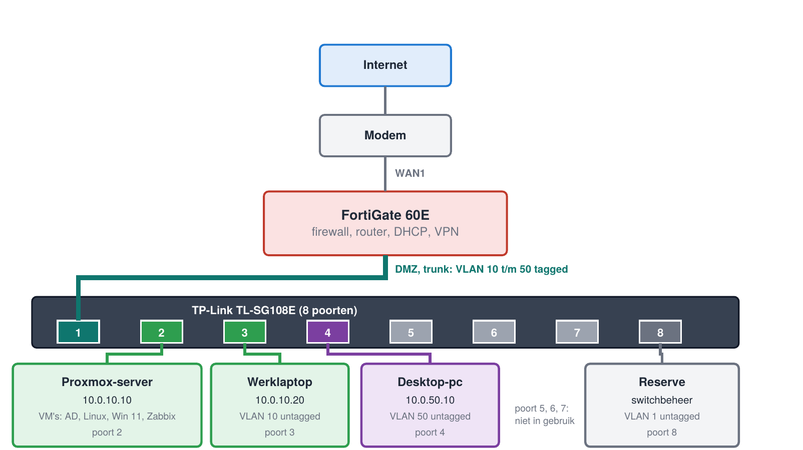
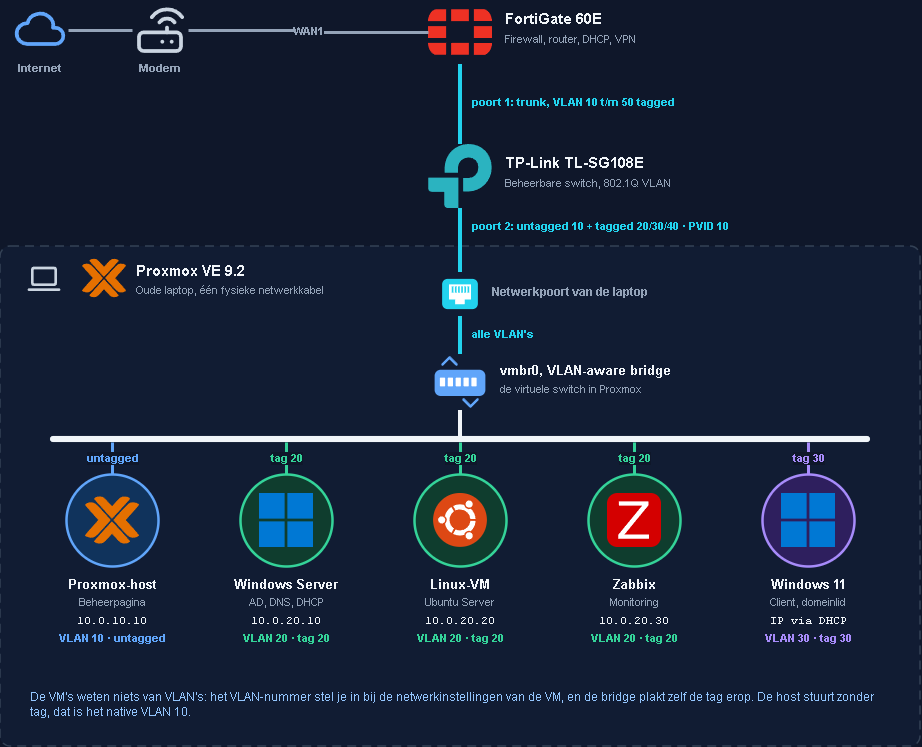

# Home Network Lab

Een kleinschalige bedrijfsomgeving, opgebouwd vanuit mijn passie voor systeem- en netwerkbeheer. De infrastructuur bestaat uit een gebruikte FortiGate 60E die fungeert als firewall en router, een beheerbare TP-Link-switch die het netwerk onderverdeelt in vijf VLAN’s en een Proxmox-server waarop verschillende virtuele machines draaien, waaronder Active Directory, Linux, Windows 11 en Zabbix.

In de eerste fase maak ik gebruik van Tailscale VPN voor externe toegang. Ik documenteer de configuratie, de werking en de gemaakte keuzes. Zodra deze opstelling naar behoren functioneert en volledig gedocumenteerd is, schakel ik over naar een IPsec VPN-oplossing van Fortinet. Zo bouw ik stap voor stap een gestructureerde, veilige en goed gedocumenteerde IT-omgeving op, waarin ik mijn kennis van systeem- en netwerkbeheer verder kan ontwikkelen en in de praktijk kan toepassen.

Het doel is praktijkervaring met netwerken, servers en beveiliging in één samenhangende omgeving, en dat aantoonbaar vastleggen.

## Status

| Onderdeel | Status |
|---|---|
| Proxmox VE 9.2 op de server-laptop | Klaar |
| Tailscale: Peer-to-peer mesh-netwerk (WireGuard) | Klaar |
| FortiGate 60E: VLAN's, DHCP, firewallbeleid | Gepland (hardware besteld) |
| VLAN's op de TL-SG108E | Gepland |
| Active Directory, DNS, DHCP, GPO's | Gepland |
| Windows 11-client aan het domein | Gepland |
| Linux-VM | Gepland |
| Zabbix-monitoring | Gepland |
| Back-ups met restore-test | Gepland |
| IPsec-VPN (remote access) | Gepland |

Deze tabel wordt bijgewerkt naarmate het project vordert.

## Wat er gebouwd wordt

- **Netwerk:** vijf VLAN's (beheer, servers, clients, gasten, thuis) met een trunk naar de FortiGate en firewallbeleid tussen de zones.
- **Servers:** Windows Server 2025 met Active Directory, DNS, DHCP, Group Policies en een fileserver, plus een Linux-VM.
- **Virtualisatie:** Proxmox VE met een VLAN-aware bridge, zodat VM's in verschillende VLAN's op één host draaien.
- **Monitoring en back-up:** Zabbix met meldingen en een geteste restore.
- **Toegang op afstand:** Tailscale-VPN/ IPsec-VPN op de FortiGate, gekoppeld aan Active Directory.

## Netwerkontwerp in het kort

| VLAN | Naam | Netwerk | Gateway | Gebruik |
|---|---|---|---|---|
| 10 | Beheer | 10.0.10.0/24 | 10.0.10.1 | Werklaptop, Proxmox-beheer |
| 20 | Servers | 10.0.20.0/24 | 10.0.20.1 | Active Directory, Linux, Zabbix |
| 30 | Clients | 10.0.30.0/24 | 10.0.30.1 | Windows 11 client-VM's |
| 40 | Gasten | 10.0.40.0/24 | 10.0.40.1 | Alleen internet |
| 50 | Thuis | 10.0.50.0/24 | 10.0.50.1 | Desktop-pc, alleen internet |

Alle apparaten hangen achter de FortiGate. Er komt één kabel van de modem binnen (naar WAN1). De DMZ-poort van de FortiGate is een trunk naar poort 1 van de switch. De desktop-pc zit in een eigen VLAN en blijft los van het lab.

## Hardware

| Onderdeel | Rol |
|---|---|
| FortiGate 60E (gebruikt) | Firewall, router, DHCP, VPN |
| TP-Link TL-SG108E | Beheerbare switch (802.1Q VLAN) |
| Oude laptop | Proxmox-server |
| Werklaptop | Beheerstation |
| Desktop-pc | Gewone pc in een eigen VLAN |
| Consolekabel USB naar RJ45 (FTDI) | Noodtoegang tot de FortiGate |

## Software

Proxmox VE 9.2, Windows Server 2022 en Windows 11 (evaluatieversies), Ubuntu Server, Zabbix, FortiOS, draw.io, PuTTY, Rufus.

## Documentatie

| Document | Inhoud |
|---|---|
| [Netwerkontwerp](docs/netwerk.md) | VLAN-plan, IP-schema, poortindeling, trunk en access, firewallbeleid |
| [Proxmox](docs/proxmox.md) | Installatie, VLAN-aware bridge, virtuele machines |
| [Problemen en oplossingen](docs/troubleshooting.md) | Wat misging en hoe het is opgelost |

De tekening staat in [diagrams/](diagrams/). `home-network.drawio` is bewerkbaar in draw.io.

## Beperkingen

- De TL-SG108E is een Easy Smart-switch: webinterface, geen CLI, geen configureerbare STP en geen 802.1X of SNMP.
- Een gebruikte FortiGate heeft meestal geen actief FortiGuard-abonnement, dus IPS, antivirus en webfilter zijn niet beschikbaar. Routering, VLAN's, firewallbeleid, NAT, DHCP, logging en VPN werken wel.
- Het lab draait op één host, dus er is geen hoge beschikbaarheid.

## Mogelijke uitbreidingen

- Tweede Proxmox-host voor een cluster met live migration.
- Site-to-site VPN naar een pfSense-VM.

## Veiligheid van deze repository

In deze repository staan geen wachtwoorden, sleutels of ongefilterde back-ups. Zie `.gitignore`.

## Auteur

Zakaria El Habib
