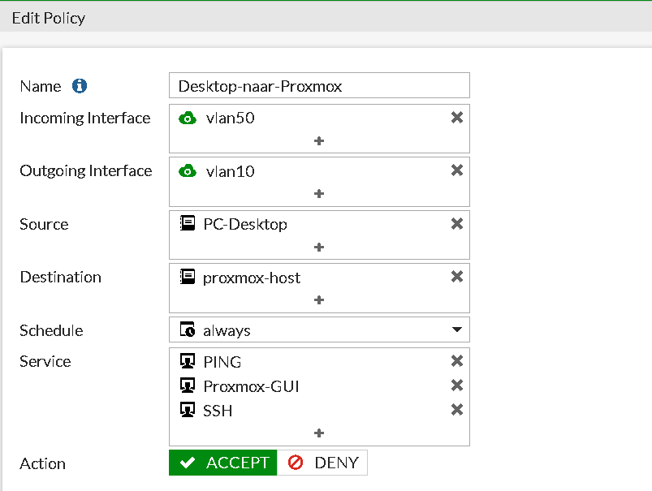
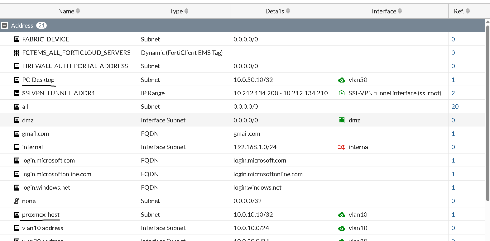
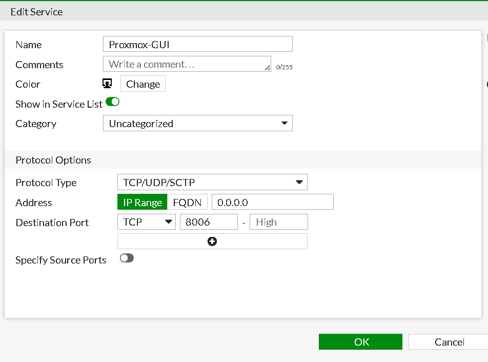
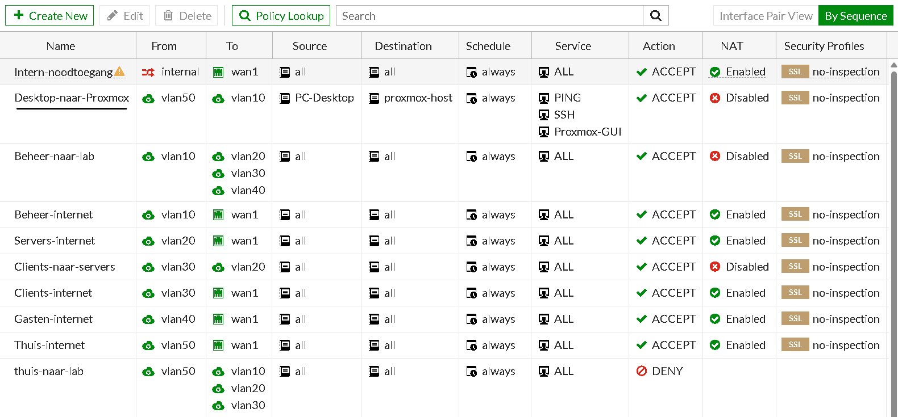
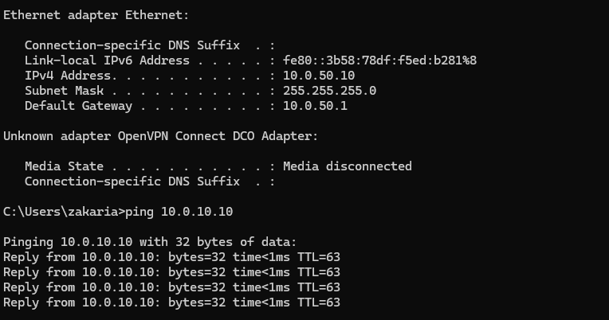
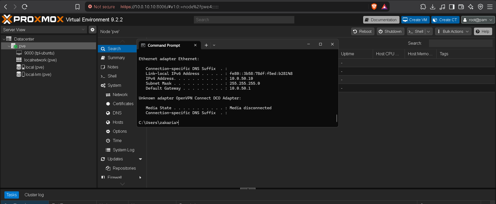
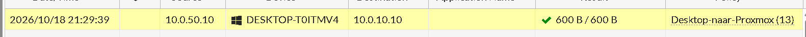
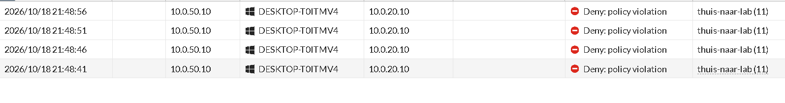

# Uitzondering: desktop-pc naar Proxmox

Mijn ontwerp zegt dat Thuis (VLAN 50) los blijft van het lab. Op één punt maak ik een bewuste uitzondering: ik wil Proxmox kunnen beheren vanaf de desktop-pc. Mijn werklaptop heeft nog geen VPN naar het lab. Tailscale reikt alleen tot de Proxmox-host en de IPsec-VPN komt pas in fase 2.

## De regel

| Instelling | Waarde |
|---|---|
| Naam | `Desktop-naar-Proxmox` |
| Van, naar | vlan50 naar vlan10 |
| Bron | `PC-Desktop` (`10.0.50.10/32`) |
| Bestemming | `Proxmox-host` (`10.0.10.10/32`) |
| Services | PING, SSH, `Proxmox-GUI` (TCP 8006) |
| Actie | Accept |
| NAT | Uit |
| Logging | Alle sessies |
| Positie | Boven `Deny-thuis-naar-lab` |

## Zo heb ik het gedaan

1. Bij *Policy & Objects → Addresses* twee adresobjecten aangemaakt: `PC-Desktop` en `Proxmox-host`, allebei als `/32`.

   

2. Bij *Services* een eigen service `Proxmox-GUI` gemaakt met TCP-poort 8006.

   

3. Bij *Firewall Policy* de regel aangemaakt en in de weergave *By Sequence* boven de deny-regel gesleept.

   

## Waarom zo

- **Boven de deny-regel.** De FortiGate leest van boven naar beneden en de eerste passende regel wint. Staat de regel eronder, dan wordt hij nooit bereikt.
- **Alleen deze pc, deze host en deze services.** Zo blijft de rest van VLAN 50 geblokkeerd. Omdat de regel op één IP-adres geldt, heeft de desktop-pc een vast adres buiten de DHCP-range.
- **Poort 8006 als eigen service.** De Proxmox-webinterface draait niet op HTTP of HTTPS (80 en 443). Die heb ik dus niet nodig en laat ik weg.
- **NAT uit**, omdat dit intern verkeer is. Logging staat aan, zodat ik zie wat er gebeurt.

## Wat misging

- **Eerst kon ik niet pingen**, ook niet nadat ik de deny-regels had uitgezet. De FortiGate weigert alles wat niet expliciet is toegestaan (impliciete deny). Ik had dus een toestaan-regel nodig, niet het uitzetten van de deny-regels.
- **De adresobjecten verschenen niet in de keuzelijst.** Het venster toont alleen objecten die bij de gekozen interface horen. Controleer bij het object of de juiste interface (of `any`) is ingesteld.
- **De Proxmox-poort staat niet in de standaardlijst** van services, dus ik moest hem zelf aanmaken.
- **Mijn pc had een DHCP-adres.** In het log zag ik als bron `10.0.50.100` in plaats van `10.0.50.10`. Mijn regel gold alleen voor `.10`, dus het verkeer viel door naar de deny-regel. Ik heb de pc een vast IP gegeven (`10.0.50.10`), en daarna werkte de regel.

  

- **Eerst zag ik geen Accept in het log.** Bij een nieuwe regel staat logging op *Security Events*, en dan logt een toegestane sessie niet. Ik heb *Log Allowed Traffic* op *All Sessions* gezet.

## Test

- [x] Ping van de desktop-pc naar `10.0.10.10` werkt.
- [x] Het log (*Log & Report → Forward Traffic*) toont Accept voor deze regel.
- [ ] `https://10.0.10.10:8006` opent de Proxmox-webinterface.
- [ ] Ping naar een ander adres in het lab (bijvoorbeeld `10.0.20.10`) is geblokkeerd.
- [ ] `https://10.0.10.1` (FortiGate-beheer) laadt niet vanaf de desktop-pc.

## Risico en later

Dit breekt bewust het uitgangspunt dat Thuis los blijft van het lab. Ik beperk het tot één pc, één host en drie services. Zodra de IPsec-VPN werkt, beheer ik Proxmox via de VPN en verwijder ik deze regel.
