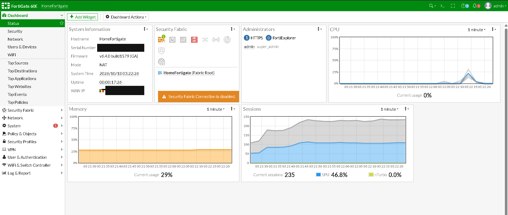
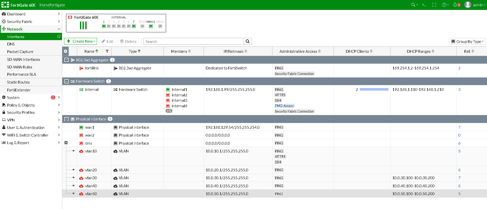
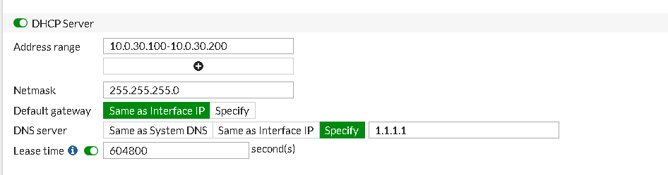
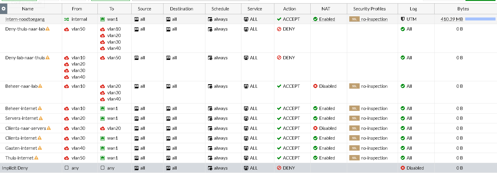
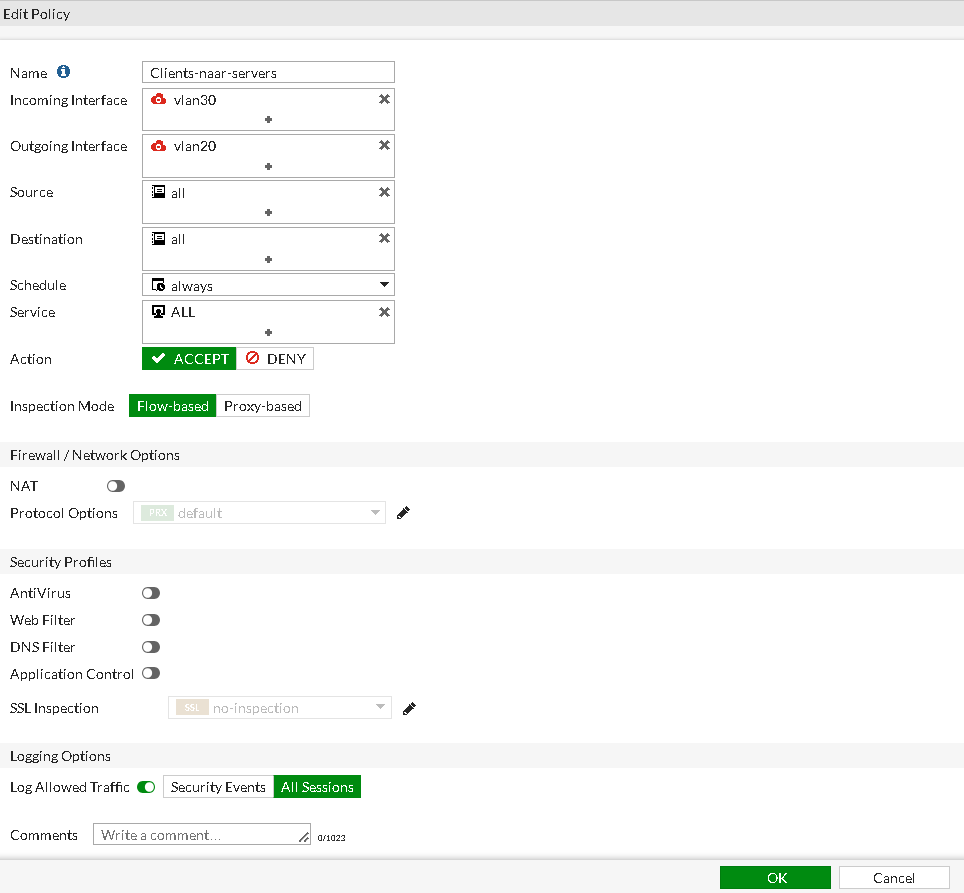

# FortiGate 60E

Hier leg ik vast hoe ik de FortiGate heb ingesteld en waarom ik bepaalde keuzes heb gemaakt. Het ontwerp zelf (VLAN-plan, IP-schema, firewallbeleid) staat in [netwerk.md](netwerk.md). Dit document laat zien hoe dat in de praktijk is uitgevoerd.

**Let op bij de screenshots.** De screenshots in dit document zijn genomen tijdens het bouwen en worden niet opnieuw gemaakt. De eerste tonen nog de situatie zonder switch (rode VLAN-interfaces, oranje driehoekjes). In sommige latere screenshots staan de deny-regels lager in de lijst dan het ontwerp. De uitleg staat in de [README](../README.md#let-op-bij-screenshots-en-logging).

## 1. Beginsituatie

De FortiGate is gebruikt gekocht. Het is een 60E met FortiOS 6.4.0, hostname `HomeFortigate`. Ik beheer hem lokaal via `https://192.168.1.99`, het standaardadres van de interne poorten. Serienummer en publiek IP heb ik onleesbaar gemaakt.

Keuzes:
- **Geen FortiCloud-account.** Ik heb het niet nodig voor VLAN's, DHCP, firewallbeleid of VPN, en ik wil het apparaat niet aan cloudbeheer koppelen.
- **Geen firmware-update.** Firmware downloaden vraagt een geregistreerd apparaat met support, en dat heb ik niet. Ik werk dus met 6.4.0. De menu's wijken daardoor soms af van nieuwere handleidingen.
- **Geen licenties.** FortiCare en FortiGuard zijn niet actief, dus er zijn geen antivirus, IPS of webfilter. Daarom gebruiken alle regels `no-inspection`.
- **Een oude firmware heeft bekende kwetsbaarheden.** Daarom zet ik beheertoegang vanaf internet uit (zie hieronder).

## 2. Interfaces en VLAN's

Ik heb de vijf VLAN's aangemaakt als subinterfaces, steeds met `10.0.<VLAN>.1/24` als gateway:

| Interface | VLAN | Gateway |
|---|---|---|
| vlan10 | 10 Beheer | 10.0.10.1 |
| vlan20 | 20 Servers | 10.0.20.1 |
| vlan30 | 30 Clients | 10.0.30.1 |
| vlan40 | 40 Gasten | 10.0.40.1 |
| vlan50 | 50 Thuis | 10.0.50.1 |

**Waarom op de DMZ-poort:** de VLAN's hangen onder `dmz`, en die poort gaat straks als trunk naar poort 1 van de switch. De DMZ is een losse interface. De poorten `internal1` t/m `internal7` zitten samen in een hardware switch, en op zo'n poort kun je niet zomaar VLAN-subinterfaces maken. De `dmz`-interface zelf heeft nu IP `0.0.0.0`, omdat alleen de VLAN's erop werken.

**Beheertoegang.** Standaard stond op `dmz` HTTPS, HTTP, FMG-Access en Security Fabric aan, op `10.10.10.1`. Dat heb ik allemaal uitgezet. Nu geldt:

| Interface | Toegang |
|---|---|
| wan1, wan2, dmz | Alleen PING |
| vlan10 | PING, HTTPS, SSH |
| vlan20, 30, 40, 50 | Alleen PING |

Waarom zo:
- De FortiGate hangt via de modem aan internet. Met een oude firmware wil ik de beheerpagina niet vanaf buiten bereikbaar hebben, dus op WAN staat geen HTTPS, SSH of FMG-Access.
- **Alleen VLAN 10 mag beheren.** Eerst had vlan50 ook HTTPS, zodat ik vanaf de desktop-pc kon werken. Dat heb ik teruggedraaid, want Thuis moet los blijven van het lab. Een deny-regel is daarvoor niet genoeg: beheer loopt niet via het firewallbeleid, maar via de toegang per interface.

**Wat er nog staat.** De interne interface (`192.168.1.99`) laat ik voorlopig zoals hij is, als fysieke noodtoegang tijdens het bouwen. HTTP heb ik daar uitgezet. Op het screenshot hierboven zijn de VLAN-interfaces rood (down), omdat de switch er toen nog niet aan hing. Dat was normaal. Inmiddels hangt de switch eraan en zijn ze up. Let ook op de interne interface: daar staan FMG-Access en Security Fabric Connection nog aan (zie Nog te doen).

WAN1 krijgt van de modem een privéadres (`192.168.129.54`). De modem doet dus zelf ook NAT. Ik heb daarom `10.0.x.x` gekozen, zodat de adresbereiken niet botsen.

## 3. DHCP

De FortiGate deelt de adressen uit in VLAN 30, 40 en 50, met de range `.100` t/m `.200` en de interface als gateway. VLAN 10 en 20 hebben vaste adressen (Proxmox en de servers).

**Waarom de FortiGate en geen DHCP-relay:** ik wilde eerst een relay naar de Windows Server gebruiken. Dat heb ik laten varen. Zo heb ik één DHCP-server en hangt het niet af van een VM die nog niet bestaat. De Windows Server doet alleen Active Directory en DNS.

**DNS voor VLAN 30:** voorlopig `1.1.1.1`, want de domeincontroller bestaat nog niet. Zodra Active Directory draait, zet ik dit op `10.0.20.10`. Anders kan de Windows 11-client het domein niet vinden en dus niet toetreden.

## 4. Firewallbeleid

De volledige tabel met de regels staat in [netwerk.md](netwerk.md#firewallbeleid). Dit zijn de keuzes die ik heb gemaakt:

- **Deny-regels bovenaan.** De FortiGate leest van boven naar beneden en de eerste passende regel wint. Met `Deny-thuis-naar-lab` en `Deny-lab-naar-thuis` bovenaan kan geen enkele toestaan-regel eronder Thuis (VLAN 50) en het lab met elkaar verbinden. Daardoor kan ook Beheer niet bij VLAN 50. Op sommige latere screenshots staan deze twee regels lager, onder `Thuis-internet`, en heten ze `thuis-naar-lab` en `lab-naar-thuis`. Dat werkt nu hetzelfde, want de regels erboven hebben een andere bestemming. Het ontwerp blijft: deny bovenaan.
- **NAT alleen naar internet.** Bij `Beheer-naar-lab` en `Clients-naar-servers` staat NAT uit, omdat dat intern verkeer is. Alleen de regels naar `wan1` hebben NAT aan.
- **Elke regel apart.** Ik had de internetregels kunnen samenvoegen, maar ik laat ze gescheiden, zodat ik later per zone iets kan aanpassen.
- **Logging op alle sessies** bij mijn eigen regels, zodat ik straks kan zien wat er geblokkeerd of toegestaan wordt. `Intern-noodtoegang` logt alleen UTM-events.
- **Impliciete deny onderaan.** Alles wat niet expliciet is toegestaan, wordt geweigerd. Deze regel logt zelf niet (standaard *Disabled*). Dat laat ik zo. Mijn eigen deny-regels loggen wel.
- **`Intern-noodtoegang`.** Dit is de standaardregel van de FortiGate (`internal` naar `wan1`) die ik een naam heb gegeven. Ik heb hem nodig om met mijn laptop op de interne poort online te blijven. Zodra de switch, de trunk en de tests werken, zet ik hem eerst op *disabled* en verwijder ik hem daarna eventueel. De VLAN's hebben hun eigen internetregels en blijven werken. Mijn toegang tot `192.168.1.99` hangt niet van deze regel af.

De oranje driehoekjes naast de regels kwamen doordat de VLAN-interfaces toen nog down waren. Dat is inmiddels opgelost.

## 5. Voorbeeld: één regel in detail

`Clients-naar-servers` laat VLAN 30 naar VLAN 20 door, met NAT uit en logging aan. De hit count is 0, want er is nog geen verkeer. De service staat voorlopig op `ALL`. Zodra Active Directory draait, beperk ik dit tot wat echt nodig is: DNS, Kerberos, LDAP en SMB.

## 6. Uitzondering: desktop-pc naar Proxmox

Ik heb één regel toegevoegd waarmee de desktop-pc (`10.0.50.10`) Proxmox (`10.0.10.10`) kan beheren. Dat is een bewuste uitzondering op "Thuis blijft los van het lab", zolang mijn werklaptop nog geen VPN naar het lab heeft. De regel staat boven de deny-regels en is beperkt tot PING, SSH en poort 8006. Details, keuzes en tests staan in [desktop-naar-proxmox.md](desktop-naar-proxmox.md).

## Gedaan sinds de eerste screenshots

- Switch ingesteld (VLAN's, PVID's) en de kabel van de DMZ naar poort 1 gestoken.
- Getest met de desktop-pc op poort 4: adres `10.0.50.10`, ping naar Proxmox via de FortiGate en een geblokkeerde verbinding naar `10.0.20.10` in het log. De details staan in [desktop-naar-proxmox.md](desktop-naar-proxmox.md).

## Nog te doen

- Op de interne interface FMG-Access en Security Fabric Connection uitzetten.
- Beheer vanaf VLAN 10 testen en daarna *Trusted Hosts* instellen op het admin-account (`10.0.10.0/24`). Dit doe ik pas na de test, anders sluit ik mezelf buiten.
- `Intern-noodtoegang` uitzetten.
- `Desktop-naar-Proxmox` verwijderen zodra de IPsec-VPN werkt.
- DNS van VLAN 30 omzetten naar `10.0.20.10` zodra Active Directory draait.
- IPsec-VPN (fase 2), met regel 10 in het firewallbeleid.
