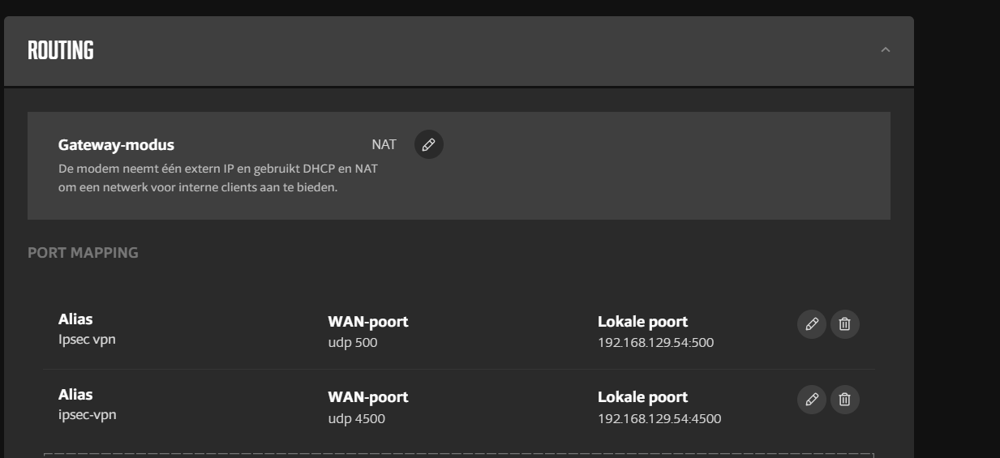

# FortiGate IPsec Dialup VPN: documentatie

Remote-access VPN (`remote-VPN`) voor toegang tot het lab (vlan10, vlan20, vlan30).

## Belangrijk

- **NAT Traversal staat aan (Enable).** Er staat een modem voor de FortiGate met port forwarding van **UDP 500** (IKE) en **UDP 4500** (NAT-T) naar `wan1`. De FortiGate zit dus achter NAT. Zonder NAT-T werkt de tunnel niet.
- **IKE versie 1 met Main mode (ID protection).** Main mode verbergt de identiteit tijdens de onderhandeling en is veiliger dan Aggressive.
- **Pre-shared key van 30+ tekens.** Lang genoeg om offline kraken praktisch onmogelijk te maken.
- **Diffie-Hellman groep 19 en 20** in Phase 1, groep 20 voor PFS in Phase 2.

---

## 1. Network

---

## 2. Authentication

---

## 3. Phase 1 Proposal

---

## 4. Phase 2 Selectors

---

## 5. port forwarding 4500 & 500

---
