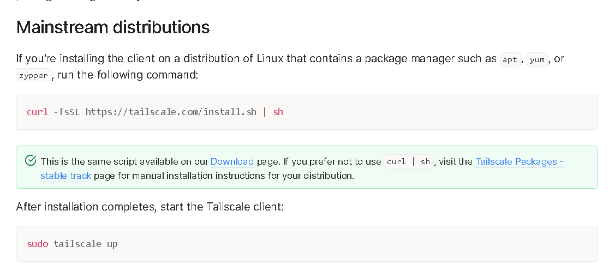
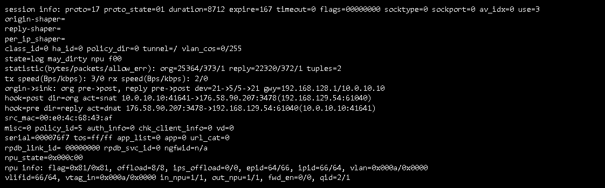
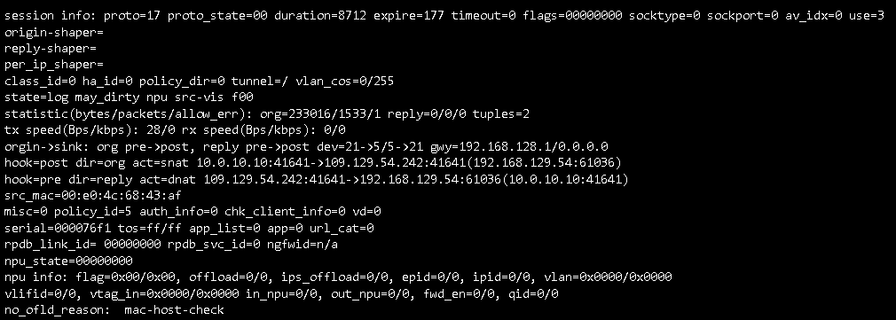

# VPN fase 1: Tailscale

Datum: 19/10/2026

## Doel

Externe toegang tot de Proxmox-host, zonder poorten open te zetten op de FortiGate. Tailscale is fase 1. In fase 2 komt een IPsec-VPN die op de FortiGate eindigt.

Wat Tailscale hier wel en niet doet:

- Het verbindt de Proxmox-host, de werklaptop en de desktop-pc in één tailnet.
- Het adverteert **geen subnet routes**. Via Tailscale is dus alleen de Proxmox-host bereikbaar, niet de VM's, de FortiGate of de rest van het lab.

## Installatie op de Proxmox-host

## Clients toevoegen

## Firewall

Tailscale maakt alleen een uitgaande verbinding vanaf de Proxmox-host (zie [Theorie](#theorie-hoe-tailscale-werkt-en-de-fortigate-omzeilt)). Het verkeer loopt dus niet door het firewallbeleid heen, maar de host moet wel naar internet kunnen: dat regelt `Beheer-internet`.

## Gevolgen voor het ontwerp

- De desktop-pc (VLAN 50) bereikt de Proxmox-host nu via Tailscale, buiten het firewallbeleid om. De FortiGate kan dit verkeer dus niet filteren of loggen.
- Daarom zijn er geen subnet routes: de blootstelling blijft beperkt tot de host zelf. In fase 2 loopt externe toegang via de IPsec-VPN op de FortiGate, waar het verkeer wel onder het firewallbeleid valt.

## Theorie: hoe Tailscale werkt en de FortiGate omzeilt

Tailscale is een mesh-VPN bovenop **WireGuard**. Elk toestel krijgt een eigen sleutelpaar en een vast IP uit `100.64.0.0/10`, op een aparte interface (`tailscale0`).

- **Controlevlak:** de toestellen melden zich via HTTPS (TCP 443) aan bij de coördinatieserver van Tailscale. Die wisselt alleen publieke sleutels en endpoints uit, er loopt geen nuttig verkeer langs.
- **Dataverkeer:** de data gaat versleuteld via WireGuard over **UDP** (standaardpoort **41641**), bij voorkeur rechtstreeks tussen de toestellen.
- **Geen open poort nodig:** de host stuurt zelf **uitgaande** pakketten naar buiten. De firewall maakt daarvoor een sessie aan en laat het antwoord als return traffic binnen. Zo kunnen de toestellen elkaar bereiken zonder inkomende poort (*UDP hole punching*). Lukt een directe verbinding niet, dan gebruikt Tailscale een relay (DERP) over TCP 443.

### Waarom dit langs het firewallbeleid loopt

De FortiGate beoordeelt alleen nieuwe sessies volgens het beleid. Hier ziet hij enkel uitgaande sessies van de Proxmox-host. Het verkeer komt aan op `tailscale0` van de host zelf en wordt nooit door de FortiGate het interne netwerk in gerouteerd. De inhoud is versleuteld, dus de FortiGate kan hem ook niet inspecteren.

### Controle op de FortiGate

Met `diagnose sys session filter src 10.0.10.10` en `diagnose sys session list` zijn de sessies van de Proxmox-host bekeken. Vastgesteld:

- Alle sessies hebben de Proxmox-host (10.0.10.10) als bron en lopen via `policy_id=5`. Er is **geen enkele inkomende sessie**.
- Het adres wordt vertaald (SNAT) naar 192.168.129.54.
- Er zijn UDP-sessies met bronpoort **41641** naar poort 3478 (STUN) en naar het publieke IP van een peer.
- Er zijn TCP-sessies naar poort 443.

**Sessie 1: werkend STUN-verkeer**

- `proto=17` en `10.0.10.10:41641 -> 176.58.90.207:3478`: de Proxmox-host stuurt vanaf UDP-poort 41641 naar poort 3478 van een server op internet. De sessie is dus **uitgaand**.
- `proto_state=01` en `reply=22320/372`: de server antwoordt, de sessie is opgebouwd en er gaat verkeer in twee richtingen.
- `act=snat` en `policy_id=5`: de FortiGate vertaalt het adres en laat het verkeer toe via het beleid voor uitgaand verkeer.
- De host gebruikt dit om zijn publieke IP en poort te ontdekken, zodat de andere toestellen hem kunnen bereiken zonder open poort.

**Sessie 2: uitgaande poging naar een peer**

- `10.0.10.10:41641 -> 109.129.54.242:41641`: de host stuurt UDP van poort 41641 naar poort 41641 van een peer, dus een directe WireGuard-verbinding.
- `org=233016/1533` en `reply=0/0/0`: de host stuurde 1533 pakketten, maar er kwam geen antwoord terug. Daarom staat `proto_state=00`: de sessie is niet opgebouwd.
- Op dit moment lukte de directe verbinding met deze peer dus niet (bv. omdat de peer offline is of de hole punching mislukte).
- Ook hier is de sessie alleen uitgaand: de FortiGate heeft geen inkomende sessie of port forward nodig.
